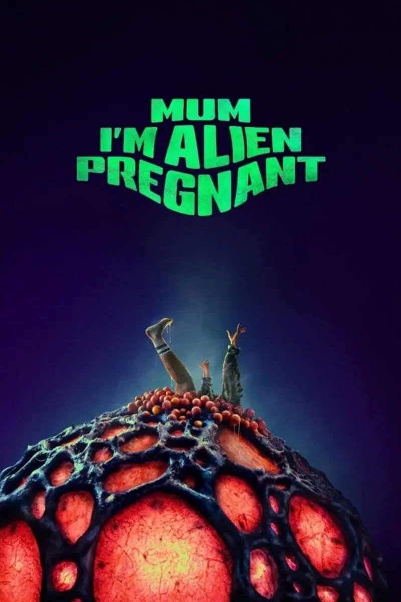

이제는 AI까지 더해져 어마어마한 영상물이 쏟아져 나오는 세상에서 살고 있습니다.  
이 모든 영상, 특히 영화/드라마를 전부 볼 수 없기 때문에 호러/수사물 위주로 보고 있는데, 간만에 좋은 작품을 보게 되어 대단히 기쁩니다. 이런 장르에서 이 정도의 작품은 1년에 몇 편 보기 어렵습니다.   
개인적인 별점은 [8/10](/ratings) 입니다.  

장르는 정하기 나름인데, rottentomatoes 에서는 **Comedy / Horror / Sci-Fi**, IMDB 에서는 **Comedy / Fantasy / Horror / Sci-Fi** 로 설정했습니다. 제가 정한다면 호러의 느낌은 약하니까 **Comedy / Sci-Fi** 입니다.  

Mum, I'm Alien Pregnant  
뉴질랜드 영화라서 Mom이 아닌 영국식 Mum 인 것 같고, 제목에 **엄마**를 넣은 것은 좋은 선택인 것 같습니다.  
포스터는 좀 아쉽습니다.  

제목 자체가 큰 줄거리이고, 임신, 출산 그리고 약간의 육아를 보여주는데 이 전체 과정에서 **PC와 페미니즘**때문에 불편해하실 분들이 존재하겠구요.  
**백인 미녀**가 주인공이 아니라 라틴계열인 것 같으면서도 소수민족스러운 여배우인 것부터 조금이라도 거부감들면 이 영화를 보면 안됩니다.  
10대는 청불이지만 호기심에 본다해도 이해도 안될 뿐더러 의미도 없겠고, 징그럽고 기괴한 이런 것에 크게 반감 없고 이런 저런 장르 가리지 않고 많이 보시는 분들에게는 정말 추천합니다.  

이 영화의 가장 큰 장점을 하나 꼽으라면 **배우들의 연기력**입니다.  
포스터랑 줄거리, 장르만 봐도 흔한 B급 영화에 연기력이 뭔 상관?  줄거리 특이하고 CG가 어색하지 않은 것이 더 중요한 것 아닌가?  <mark>NO!</mark>  

이 영화는 수입해도 돈을 벌 수 없기 때문에 국내 정식 개봉할 가능성은 없다고 봐도 되겠지만, 혹시 한다면 또 소지섭씨가?  